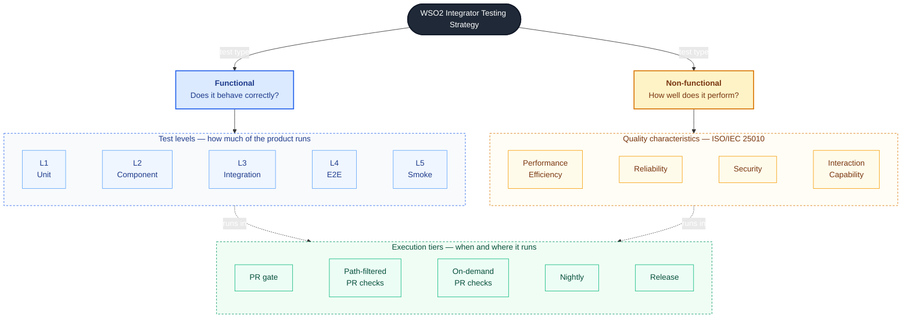
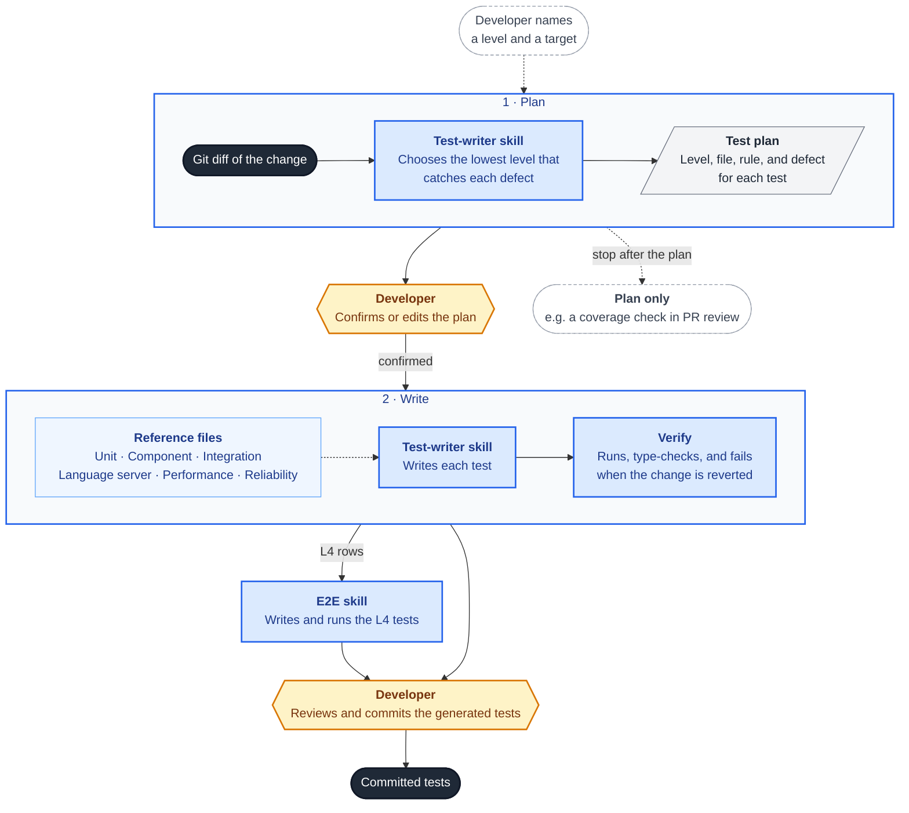

# Testing Strategy

_Authors_: @NipunaRanasinghe \
_Reviewers_: @keizer619, @anupama-pathirage, @nipunayf, @madushajg \
_Created_: 2026/08/10 \
_Updated_: 2026/11/05

This document defines the testing strategy for the WSO2 Integrator product, including the VS Code extensions and the IDE. It defines the test types and levels, when each suite runs in CI, the conventions that apply to every test, and the agent skills that apply them when a test is written.

## Testing Model

Each test is described by three independent properties:

- **Type:** what the test checks. Functional tests verify that the product behaves correctly. Non-functional tests measure how well it performs, such as latency, memory use, or security.
- **Level:** how much of the product the test runs, from one function with mocked dependencies to the packaged IDE. Higher levels cover more of the product but run slower and cost more to maintain.
- **Tier:** when the test runs in CI, and whether a failure blocks a merge or a release.

The properties vary independently: a performance test can target a single function or the packaged IDE, and the same test can run in more than one tier. Tests are therefore not organized into a single pyramid. Each defect should be caught at the lowest-cost level that can detect it, in a tier that blocks the change before release. E2E is the exception: it never blocks, so a defect that only E2E catches can ship after triage.

## Functional Testing

Functional tests verify that the product behaves as specified. Five levels define how much of the product a test runs. Most tests should sit at L1 and L2, the two lowest-cost levels.

| Level | Purpose | Scope | Real vs mocked |
|---|---|---|---|
| L1 — Unit | Detect logic errors on the PR that introduces them | One function or class | Nothing external; local files, recorded responses, and an installed runtime |
| L2 — Component | Verify rendering and wiring without launching the IDE | One component and its direct dependencies | Component real; language server replaced by recorded responses |
| L3 — Integration | Verify that independently released components work together | Real cross-process boundaries | Real language server, runtime, and files; no UI |
| L4 — E2E | Verify complete user workflows in the built product | Full UI, against built artifacts (VSIX or packaged IDE) | Everything real (built artifacts) |
| L5 — Smoke | Determine whether a packaged build is fit to release | Packaged installer | Real installed product |

### Unit Tests

A unit test runs one function, class, or module in a single process, with no network access and without starting another process. It must be deterministic. Local files, recorded responses, and an installed runtime distribution are allowed; external collaborators are stubbed.

Unit tests target code that transforms, parses, maps, or validates: request and response mappers, diagnostic parsers, state reducers, and language server logic such as completion, hover, and code actions. A failure identifies the function that broke, so it can be fixed in the same PR.

Contract tests that check invariants on shared enums sent over the language server or webview RPC wire are also L1.

### Component Tests

A component test runs one component with its direct dependencies, without starting a language server or launching the IDE. The `vscode` API is mocked. The component may be a webview UI component, extension activation, or the webview ↔ extension messaging bridge.

Component tests detect incorrect rendering in diagrams and form editors, broken webview ↔ extension messaging, and activation failures that prevent command registration. The language server is replaced with recorded responses (see [Test Conventions](#test-conventions)).

### Integration Tests

An integration test runs real processes on both sides of a boundary, without the IDE UI: extension ↔ language server, extension ↔ runtime, project lifecycle on the file system, and connector import. External services run as Docker Compose containers, so no manual setup is needed on a developer machine or a CI runner.

The extension, language server, and runtime are released independently. Integration tests detect a contract mismatch between them, such as an LSP request or response shape changing on one side, which each side's own tests do not catch.

### E2E Tests

An E2E test drives a complete user journey through the UI, with a real language server and runtime. It runs against built artifacts: the VSIX installed into VS Code in the plugin repos, and the packaged IDE in `product-integrator`. It never runs the extension loaded from source. E2E tests detect journeys that fail even when their individual parts pass at lower levels.

Tests use Playwright with the page object model, and capture screenshots, video, and logs on failure. Each test is independent and tagged by feature area for selective runs.

A test that fails and then passes on an unchanged re-run is flaky. Quarantine it as soon as it is confirmed flaky, and fix it within one sprint.

### Smoke Tests

A smoke test runs the freshly packaged installer in under five minutes to determine whether the build is fit to release. It detects build and packaging failures such as launch failures, extension activation failures, and missing bundled resources. `wso2ipw`, the Integrator automation tool, drives the installer. Smoke tests apply only to the product distribution.

> **Note:** Smoke tests cover breadth rather than depth. Deep behavioral coverage belongs at the E2E level.

## Non-Functional Testing

Non-functional tests measure how well the product performs rather than whether it behaves correctly. Each type follows a product quality characteristic from ISO/IEC 25010. They run on a consistent Linux runner class, so measurements are comparable across runs.

| Type | Purpose | Runs In |
|---|---|---|
| Performance efficiency | Keep user-facing operations within a time budget | Nightly + PR pipeline (on demand) |
| Reliability | Keep memory use and process count bounded over a long session | Nightly |
| Security | Verify credential handling and the isolation of untrusted input | Nightly |
| Interaction capability | Verify accessibility of the rendered UI | PR pipeline, once adopted |

### Performance Efficiency

Performance tests detect latency regressions in CI rather than through user reports. Measure the following against a committed benchmark:

- Language server round-trip latency for completion, hover, and diagnostics.
- Flow-model and diagram computation time for large integration files.
- Extension activation time and language server cold-start time.

The suite first runs on the fixed runner class and records results without failing. The baseline is set from those runs, so it includes normal run-to-run variance, and is committed with the tests. The gate is then a percentage over that baseline.

### Reliability

Reliability tests verify that no language server or child process remains after shutdown, and that language server memory stays within bounds during a sustained session. Leaks grow with session length and reach users as general slowness rather than as a reproducible defect.

### Security

The IDE handles cloud credentials, and compiles and runs untrusted project code and third-party connectors on the developer's machine. Security tests cover:

- **Authentication and cloud integration:** token storage and refresh, session handling, and that credentials are never written to logs or to disk in cleartext.
- **Untrusted input:** a malicious project or connector descriptor cannot read outside its workspace, run host commands, or crash the extension host.

> **Note:** Static analysis and dependency scanning inspect source and third-party packages without running the product, so they are gates rather than tests. See [Quality & Security Gates](./quality-and-security-gates.md). Dynamic scanning does not apply to the IDE itself, because the IDE exposes no network service.

### Interaction Capability

Interaction capability is the ISO/IEC 25010 characteristic that covers accessibility. It is not yet a requirement. When it is adopted, automated checks run against rendered webview components in the PR pipeline, using the render harness that component tests already require. They catch missing labels, contrast failures, and controls that cannot be reached by keyboard. The contributor adding a webview owns its checks.

## Execution Tiers

A tier defines when a suite runs and whether a failure blocks a merge or a release. A test can run in more than one tier. Pipeline triggers and labels are described in [CI/CD Pipelines](./cicd-pipelines.md).

| Tier | Trigger | What runs | Blocking |
|---|---|---|---|
| PR gate | Every PR | L1 (except language server) and L2 | Blocks merge |
| Path-filtered PR checks | PR changing language server source | Language server L1 | Blocks merge |
| On-demand PR checks | PR with the matching label | L3, L4, and performance | Advisory |
| Nightly | Scheduled | Plugin repos: L1–L4 and all non-functional suites. `product-integrator`: L5 | L3, L5, and every non-functional suite with a gate block the next stable release |
| Release | Release candidate packaging | L5 | Blocks release |

- **Language server unit tests** are L1 but run as a separate job, because they need a JDK, a Gradle build, and a runtime distribution.
- **Integration tests** never block a merge, because they need real distributions on the runner and are too slow for the PR budget. A failing nightly L3 run blocks the next stable release. The release manager checks the latest nightly status before starting the release.
- **E2E tests** never block a merge or a release. Repo maintainers must triage a failing nightly run before the next stable release.

### Platforms

- **L1, L2, and L3:** Linux and Windows. Integration tests that depend on Docker Compose services run on Linux only, because hosted Windows runners cannot run Linux containers.
- **L4 and L5:** Linux, Windows, and macOS before a release.
- **Non-functional:** Linux, on a consistent runner class.

## Test Conventions

- **Test against recorded responses:** fast tests run against committed recorded responses, not a live language server. These are real responses captured from a language server or webview RPC exchange during an E2E run, deduplicated, and committed next to the tests that use them. A nightly drift check re-runs the capture against the live language server and fails if the committed responses differ.
- **Test invariants, not individual cases:** assert a rule that must hold across a set of inputs instead of writing one assertion per known input. When a bug is fixed, add the triggering input to that set; the existing invariant then covers the regression with no new assertion.
- **Discover tests by config filename:** in Jest packages, the fast CI job runs a package's tests only if its Jest config file is named exactly `jest.config.js` and sits in a top-level package directory. A config with any other name or location is skipped without an error, so a suite that must run on every PR keeps this name. Heavier suites use other config names, so they stay out of the fast gate. Moving a heavy test into the fast gate therefore requires renaming its config, which is visible in review.
- **Place test files by level:** unit, component, and integration tests live in the package's `src/test/` directory, separate from source and from test-support code. Integration tests sit in their own subdirectory, which the fast config excludes. E2E tests sit outside `src/`, because they drive the built product rather than importing from it.

## Test Skills

Agent skills apply the level boundaries in this document when a test is written, so the choice of level does not depend on the contributor having read it. The skills read each repo's test documentation for implementation details and build recipes, rather than duplicating them.

One test-writer skill covers L1–L3, for both the TypeScript packages and the Java language server, and the performance and reliability suites in [Non-Functional Testing](#non-functional-testing). A separate E2E skill covers L4. L4 has its own skill because writing an E2E test means driving a running IDE, which the other levels do not need.

The test-writer skill keeps one reference file per level and one for the performance and reliability suites, with the decisions and pitfalls for each. It works in two stages:

1. **Plan:** it reads the git diff, chooses the lowest level that can catch each defect the change could introduce, and presents a test plan. Each row names the level, the test file, the invariant the test checks, and the defect it catches. For example, a change to an LSP response mapper gets a unit test for the mapping and an integration test for the contract.
2. **Write:** after the developer confirms or edits the plan, it writes each test using the reference file for its level. It applies the [Test Conventions](#test-conventions), so a generated test lands in the right tier. It passes L4 rows to the E2E skill.

Before reporting a test as done, the skill runs it, type-checks it, and checks that it fails when the production change is reverted. The skill rewrites or drops a test that still passes without the change.

- **A skill proposes, a developer commits:** a developer reviews generated tests like any other code.
- **Plan only:** the skill stops after the plan, for example when a reviewer checks the coverage of a PR.
- **Direct:** a developer names a level and a target, and the skill skips choosing the level.

## Product-Specific Constraints

### VS Code Fork Patches

The IDE carries patches against the upstream VS Code base. The build catches a patch that fails to apply, but not a patch that applies and no longer does what it was written to do.

- Maintain a patch regression suite that verifies every patch still functions after an upstream merge. Run it and the extension tests against a new VS Code version before adopting it.
- A patch that disables an upstream check needs a product-side test covering what the check used to cover.

### Runtime Version Compatibility

The extension and the runtime distribution are released independently. A break against a supported runtime version that CI does not test stays invisible until a user hits it.

- Run integration tests against each supported runtime distribution, not only the one the language server targets.
- Record the supported distribution range where the test matrix reads it, so adding a version to the product also adds it to the matrix.
